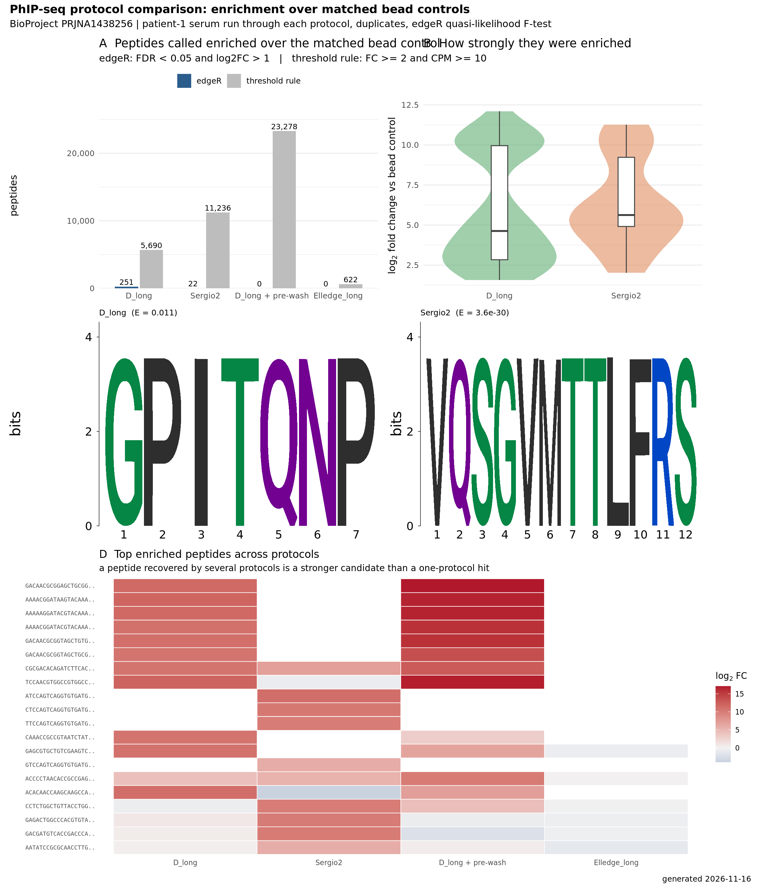
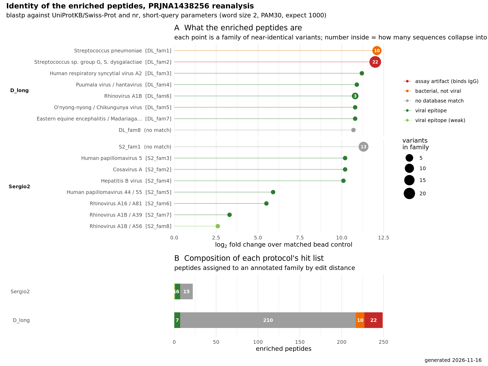

# PhIP-seq enrichment pipeline, a reanalysis of PRJNA1438256

**When a published screen calls 23,278 peptides "enriched", how many of them
are real?**



---

## The starting point

[Kjendal et al., *Frontiers in Virology* 6:1761741 (2026)](https://doi.org/10.3389/fviro.2026.1761741)
set out to fix a known weakness of VirScan phage immunoprecipitation
sequencing: poor signal-to-noise. Their own healthy-control serum, run through
the standard protocol, showed no visibly enriched peptides at all. They
proposed two changes, both borrowed from phage display panning logic
**multiple rounds of immunoprecipitation**, and a **pre-wash of the serum with
wild-type phage** to absorb non-specific binders before the library is added.

They deposited everything: [BioProject PRJNA1438256](https://www.ncbi.nlm.nih.gov/bioproject/PRJNA1438256),
48 runs. One serum sample pushed through five protocol variants, each with its
own bead-only control, all in duplicate.

Their hit-calling is three fixed thresholds: fold change over bead control
≥ 2, normalised count ≥ 10, coefficient of variation < 100. No error model, no
multiple-testing correction across ~10⁵ features.

**This repository asks what changes when you model the counts instead.**

---

## Run it

```bash
docker run --rm -v "$PWD":/work -w /work \
  -e PROTOCOLS="EL S2 DL DLPW" \
  ghcr.io/tatiorli/phipseq-enrichment:latest
```

It downloads its own data from ENA, so a clean clone reproduces every figure
and table here. `PROTOCOLS="EL"` is a 4-run, ~0.35 GB smoke test;
`"EL S2 DL DLPW"` is the full 16-run comparison (~4.6 GB).

Build locally instead, or run it on an LSF cluster, see
[Running it elsewhere](#running-it-elsewhere).

---

## Result 1, the two methods rank the protocols in opposite orders

| protocol | features tested | **edgeR**, FDR<0.05 | published threshold rule |
|---|---|---|---|
| D_long | 177,562 | **251** | 5,690 |
| Sergio2 | 118,259 | **22** | 11,236 |
| D_long + pre-wash | 128,919 | **0** | **23,278** |
| Elledge_long | 83,571 | **0** | 622 |

The pre-wash protocol produces the largest hit list by the published rule
23,278 peptides, four times any other, and **not one of them has statistical
support at 5% FDR**. Ranked by thresholds it is the best protocol in the set;
ranked by a model that accounts for count variance between replicates, it is
the one that produced nothing. The threshold counts track sequencing depth and
dispersion, not signal.

### Two different kinds of zero

The honest qualifier matters. The pre-wash arm's best FDR is **0.058**, and at
a 10% cutoff it has **7,323** hits:

| protocol | FDR<0.05 | FDR<0.10 | FDR<0.25 | between-replicate BCV |
|---|---|---|---|---|
| D_long | 251 | 362 | 698 | 1.23 |
| Sergio2 | 22 | 32 | 45 | 1.50 |
| D_long + pre-wash | 0 | **7,323** | 21,103 | 1.05 |
| Elledge_long | 0 | 0 | 0 | 0.25 |

So the pre-wash arm is a **broad shift sitting exactly on the significance
cliff**, not an absence of signal. Elledge_long, by contrast, has nothing at
any cutoff, and the only features that *are* significant there are
**depleted**: present at ~700 CPM in the bead control and absent from serum,
i.e. bead binders the serum strips out.

Two protocols, two very different zeros, distinguishable only because the
dispersion was modelled. With n = 2 per arm and BCV above 1 in three of four
protocols, the individual hits are candidates; **the protocol ranking is the
result.**

---

## Result 2, what the enriched peptides actually are



The ranked lists are not 251 and 22 independent discoveries. The top of each
is dominated by families of single-residue variants, 19 of D_long's top hits
are one sequence, 13 of Sergio2's 22 are another, which de novo counting
splits into separate features.

Collapsed into families and identified by `blastp` against UniProtKB/Swiss-Prot
and nr ([raw reports here](results/blast/), [calls here](results/blast_annotation.tsv)):

**Real human-virome antigens, at 100% identity over 16 residues**

| family | protein | organism |
|---|---|---|
| DL_fam3 | major surface glycoprotein G | respiratory syncytial virus |
| DL_fam4 | nucleoprotein | Puumala hantavirus |
| DL_fam6 | genome polyprotein | rhinovirus A1B |
| DL_fam7 | nonstructural polyprotein | Eastern equine encephalitis / Madariaga |
| DL_fam5 | nonstructural polyprotein | O'nyong-nyong / chikungunya |
| S2_fam2 | genome polyprotein | cosavirus A |
| S2_fam3 | replication protein E1 | human papillomavirus 5 |
| S2_fam4 | large S protein | hepatitis B virus |
| S2_fam5 | replication protein E1 | human papillomavirus 44/55 |
| S2_fam6/7/8 | genome polyprotein | rhinovirus A16 / A39 / A56 |

For a single serum donor that is a plausible exposure history: common
respiratory viruses, papillomavirus, hepatitis B, and a few arboviral
cross-reactions.

### Checked against the actual library

BLAST says what a peptide resembles. The VirScan Vir3 library says what it is.
[`scripts/08_annotate_vir3.py`](scripts/08_annotate_vir3.py) matches every
enriched peptide against all 128,257 library tiles by exact 16-mer, then allows
one substitution ([full log](results/vir3_annotation_log.txt)):

| | D_long | Sergio2 |
|---|---|---|
| exact library member | 112 | 9 |
| library member, one substitution | 45 | 0 |
| **not in the library at all** | **94** | **13** |

**107 of 273 enriched peptides are not members of the designed pool**, even
allowing a sequencing error, so they cannot be antigen hits whatever their fold
change. Two of them are in the top five by fold change in the whole experiment,
including `IQSGVMPTLFRSLQSG`, the family carrying 13 of Sergio2's 22 hits.

The 45 single-substitution matches are error variants of real members that de
novo counting split off as separate features. That is the cost of not using the
library reference, measured rather than assumed.

Species of the confirmed members:

| D_long | n |
|---|---|
| *Streptococcus* sp. group G (IgG-binding protein G) | 22 |
| *Streptococcus pneumoniae* (histidine triad protein PhtE) | 21 |
| Rhinovirus A | 16 |
| Human herpesvirus 5 (CMV) | 12 |
| Human herpesvirus 3 (VZV) | 10 |
| Human herpesvirus 6A | 7 |
| Respiratory syncytial virus | 5 |

Sergio2 is smaller and dominated by rhinovirus A, with single peptides from
alphapapillomavirus 10, betapapillomavirus 1, hepatitis B virus and cosavirus A.
Herpesviruses, rhinovirus, RSV, HPV and HBV in one donor is a recognisable adult
serology profile.

**The largest single group is the assay control.** *Streptococcus* group G
protein G binds IgG directly, so it enriches in any serum arm against a
bead-only control regardless of antigen specificity. It is in the library on
purpose, as an immunoprecipitation efficiency control, and it behaves exactly as
it should. Reported as a discovery it would be the top false positive here.

---

## Result 3, the motifs converge on a real epitope

Motif discovery runs STREME on the enriched peptides against a background
drawn from **non-enriched peptides of the same library**, so the library's own
amino-acid composition is controlled for.

- D_long: **GPITQNP**
- Sergio2: **VQSGVMTTLFRS**, and as its second motif **IQSGPIEQNP**

The shared `GPI…QNP` core is not a coincidence, BLAST places both inside the
**rhinovirus A genome polyprotein**. Two protocols, analysed independently,
recovered the same epitope region. That is a stronger argument for a real
binder than any single ranked list, and it fell out of the motif analysis
without rhinovirus ever being mentioned to it.

---

## What the pipeline does

| stage | script | |
|---|---|---|
| 0 | `scripts/00_manifest.sh` | asks ENA for current FASTQ URLs |
| 1 | `scripts/01_download.lsf` | one run per job-array index, integrity-checked, `.done` markers |
| 2 | `scripts/02_count.lsf` | fastp to truncate to a common length to count inserts |
| 3 | `scripts/03_matrix.py` | two-pass feature × sample matrix + library QC |
| 4 | `scripts/04_enrich.R` | edgeR QL F-test vs matched bead control, per protocol |
| 5 | `scripts/05_motifs.sh` | translate hits, STREME vs non-enriched background |
| 6 | `scripts/06_figure.R` | the protocol comparison figure |
| 7 | `scripts/07_annotation_figure.R` | the BLAST annotation figure |
| 8 | `scripts/08_annotate_vir3.py` | exact match against the VirScan library |
| 9 | `scripts/09_vir3_figure.R` | library vs BLAST comparison figure |

Every stage is idempotent, rerun after any failure and finished work is
skipped. The same scripts run unmodified under Docker and under LSF.

---

## Design decisions

### The sample-to-condition mapping is not in the paper

It is not in ENA's run report either; both come back empty. It is in the NCBI
**BioSample** attributes:

```bash
curl -s "https://eutils.ncbi.nlm.nih.gov/entrez/eutils/efetch.fcgi?db=biosample&id=$(seq -s, 56533536 56533583)&rettype=full&retmode=xml"
```

Decoded, the design is 24 conditions × 2 replicates, and the same serum went
through every protocol with its own matched control, which is what makes a
clean within-protocol comparison possible. `config/samples.tsv` is that
mapping, joined to run accessions.

| code | `experiment` tag | serum | bead control |
|---|---|---|---|
| `EL` | `Elledge_long` | `EL_P1_1/2` | `EL_BC_1/2` |
| `S2` | `Sergio2` | `S2_P1_1/2` | `S2_BC_1/2` |
| `DL` | `D_long_r1/r3` | `DL3_P1_1/2` | `DL1_BC_1/2` |
| `DLPW` | `D_long_*_PW` | `DL3_P1_PW_1/2` | `DL1_BC_PW_1/2` |
| `RD` | `round1`/`round3` | `r3_P1_1/2` | `r1_BC_1/2` |

### `RD` is excluded by default

`EL`, `S2`, `DL`, `DLPW` were sequenced at **50 bp**; `RD` at **151 bp**.
Protocol is therefore confounded with read length and sequencing batch. Enable
it by setting `include=yes` for those rows in `config/samples.tsv`, and treat
any difference as protocol *plus* batch.

### Each protocol is modelled separately

A single model across protocols would confound protocol with batch and depth.
`enrichment_summary.tsv` reports both calling methods side by side; the
disagreement is the finding, not a footnote.

### Why there is no logo of the peptides themselves

A sequence logo only means something for aligned, equal-length sequences.
VirScan peptides are 56-aa tiles from hundreds of different viral proteins;
stacking them gives a smear. The pipeline asks the question the logo was meant
to answer instead, which short motif is over-represented relative to the rest
of the same library.

### An empty hit list is a result, not a failure

Only if the controls say the assay worked. `library_qc.tsv` reports reads
counted, unique peptides, Shannon diversity and the top-ten share for every
sample, so "nothing enriched" and "nothing worked" are distinguishable without
rerunning anything.

---

## Reproducibility

Run on an LSF cluster and run in Docker on a different machine, with
independently solved software environments, the pipeline returns the same
numbers to the digit: 94,760 features kept of 133,643, 83,571 tested, 0 enriched
by edgeR against 622 by the threshold rule, BCV 0.245, minimum FDR 4.5×10⁻⁶.

---

## Limitations

1. **No peptide reference used here.** The VirScan library is not deposited
   with the BioProject, so `COUNT_MODE=denovo` counts exact inserts rather than
   named library members. This fragments signal: one library peptide can appear
   as several distinct 50-mers, splitting its counts. See
   [Getting the library](#getting-the-virscan-library), this is fixable.
2. **Protocol names are partly inferred.** `_PW` (pre-wash) and
   `round1`/`round3` (IP round) are unambiguous; mapping `Elledge_long`,
   `Sergio2` and `D_long` onto the paper's five named protocols is not.
3. **n = 2 per arm.** Across ~10⁵ tests, FDR < 0.05 needs p ≈ 10⁻⁶.
4. **BLAST identification is per-family, from a 16-aa translation.** The raw
   reports are in `results/blast/` so every call can be checked.
5. 16 of the 48 BioSamples list a `.count.csv.gz` as source rather than a
   FASTQ. ENA reports non-zero read counts for all, but verify before use.

### Getting the VirScan library

The library is public, just not with this BioProject:

- **`vir3_annotations.csv.gz`**, VirScan3 peptide annotations, inside
  `data.tar.gz` at [Zenodo 10.5281/zenodo.20033894](https://doi.org/10.5281/zenodo.20033894)
  (CC BY 4.0).
- **`vir3.fasta`**, the reference FASTA, supplementary to the
  [VirScan Bio-protocol](https://doi.org/10.21769/BioProtoc.4464). Note that it
  contains only the **first 50 nucleotides** of each library member, the same
  truncation this pipeline applies, so the two are directly compatible.
- **`pep_anno`**, full annotation object in
  [`athchen/ktsp_paper`](https://github.com/athchen/ktsp_paper) (`data_raw/hiv_data.rda`).

With any of these, set `COUNT_MODE=reference` and `REF_FASTA`, and every
peptide gets a name instead of a BLAST inference.

---

## Running it elsewhere

```bash
bash scripts/00_smoke_test.sh   # verifies container, filesystem, tools, parsing
bash run_all.sh                 # submits the LSF dependency chain
```

`config/params.sh` holds queue names, per-stage memory and `CONTAINER_MODE`
(`docker-lsf`, `singularity`, `none`). Two notes that cost real time if missed:
declare memory on every job, and check whether `rusage[mem=]` is per slot or
per job on your scheduler.

---

## Output

```
results/
├── enrichment_summary.tsv      per protocol: edgeR vs threshold rule
├── enriched_peptides.tsv       the hits
├── library_qc.tsv              depth, diversity, Shannon entropy
├── blast_annotation.tsv        family to organism to call
├── vir3_annotation.tsv.gz      every feature matched to the library
├── vir3_annotation_log.txt     the run log
├── hitlist_composition.tsv     how much of each hit list is artifact
├── blast/                      raw BLAST reports + provenance
├── motifs/                     STREME input, PWMs, HTML logos
└── figures/
    ├── protocol_comparison.pdf
    ├── blast_annotation.pdf
    └── motif_logos.pdf
```

MIT licensed. Image built and smoke-tested by CI on every commit.
Data: [PRJNA1438256](https://www.ncbi.nlm.nih.gov/bioproject/PRJNA1438256),
deposited by Kjendal et al. under their own terms.
